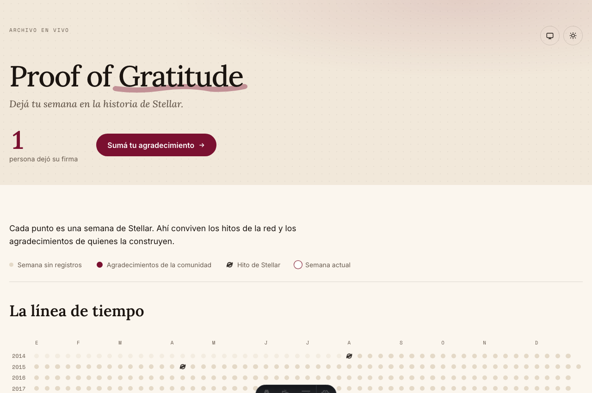

<div align="center">
  <h1>Proof of <span style="color:#7a1030">Gratitude</span></h1>

  <p><strong>La vida de Stellar, contada semana a semana.</strong></p>
  <p>Un punto por cada semana desde 2014. Los hitos de la red y las personas que la construyen, en el mismo lugar.</p>

  <a href="./CONTRIBUTING.md">✦ Dejar mi agradecimiento</a>
  &nbsp;·&nbsp;
  <a href="#sobre-stellar">Sobre Stellar</a>
  &nbsp;·&nbsp;
  <a href="#tu-primer-commit">Tu primer commit</a>

  <br><br>

  
  <a href="https://github.com/mariaelisaaraya/Proof-of-Gratitude/actions/workflows/validate.yml"></a>
  
</div>

<br>

<div align="center">
  
</div>

## Qué es esto

Proof of Gratitude es un archivo vivo de Stellar. Cada punto de la grilla es una semana desde que
la red nació. Algunos puntos marcan un hito importante de su historia. Otros se encienden porque
alguien de la comunidad dejó ahí su agradecimiento: a quién le dice gracias, por qué, y qué viene
después.

No hace falta saber programar para dejar el tuyo.

## Sobre Stellar

Stellar es una red pensada para que mover dinero y construir con él sea simple, rápido y abierto,
en cualquier parte del mundo. Alrededor de esa idea creció una comunidad de personas que aprenden,
construyen y se ayudan entre sí, y este sitio es un lugar para guardar esa parte humana.

Nació en un encuentro de esa comunidad en Buenos Aires: un día para compartir en qué está
trabajando cada quien, agradecer lo construido este año y pensar lo que viene. [Sobre el
evento](https://luma.com/starmaker-047r?tk=J0qdSN).

## Tu primer commit

No necesitás instalar nada para dejar tu historia.

1. Entrá a la carpeta [`src/content/community`](./src/content/community) y mirá el archivo
   [`_ejemplo.json`](./src/content/community/_ejemplo.json).
2. Copialo, completalo con tu historia (cuándo conociste Stellar, a quién le agradecés y por qué,
   y tu próximo paso) y guardalo con tu nombre.
3. Subilo como un Pull Request. Va a ser tu primer commit, y alguien del equipo lo revisa antes de
   sumarlo a la línea de tiempo.

La guía completa, con ejemplos, está en [`CONTRIBUTING.md`](./CONTRIBUTING.md).

## Para quienes programan

```bash
npm install
npm run dev
```

---

<div align="center">
  <p>Gracias por pasar. Si esto te movió algo, dejá tu punto en la línea de tiempo. 💛</p>
</div>
